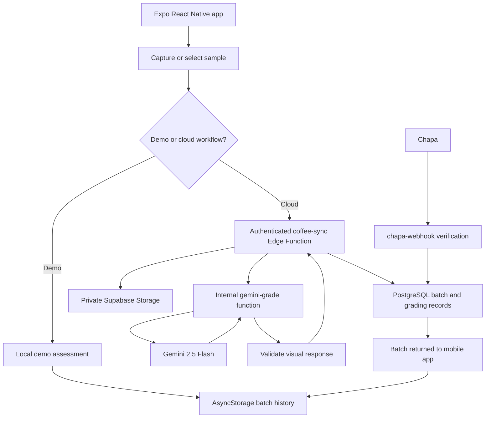

# BunaLens

**AI-assisted coffee sample screening and washing-station workflow for Jimma, Ethiopia.**

BunaLens is a mobile-first application for coffee washing stations, cooperative intake teams and coffee producers. It is designed to help operators capture coffee samples, organize batch records, review visual defect indicators and manage station-level workflows from an Android or iOS device.

The initial geographic focus is Jimma Zone. The application supports two sample types:

- **Red coffee cherries** (*Buna Diimaa*)
- **Green coffee beans** (*Buna Qullaa*)

> **Important assessment disclaimer:** BunaLens provides preliminary visual screening only. It is not an official Ethiopian Commodity Exchange (ECX) grade, Q-Grader assessment, laboratory result, export approval or buyer quotation. The current Gemini assessment deliberately returns **Unclassified** rather than claiming an unvalidated official grade. All demonstration records and benchmark prices are illustrative.

---

## 1. Product vision

Coffee quality and value are influenced by decisions made throughout collection, sorting, processing and delivery. BunaLens aims to give local washing-station operators a practical digital tool for recording those decisions and making sample information easier to review.

The product direction is to:

1. Make sample capture and batch record-keeping accessible on ordinary smartphones.
2. Provide conservative, explainable visual screening rather than unsupported claims of laboratory-grade assessment.
3. Preserve records when connectivity is unreliable and synchronize them when a station is online.
4. Keep station, sample, pricing and payment information organized in one workflow.
5. Build toward a locally validated coffee intelligence platform for Jimma and, later, other coffee-producing regions.

The product is being developed incrementally. Features that depend on live third-party services must be configured and tested before production use.

## 2. Core features

| Area | Current application capability |
|---|---|
| Dashboard | Station overview, scan credits, saved batches, recent activity and assessment summaries |
| Sample capture | Camera capture and gallery image selection |
| Sample configuration | Red cherry / green bean selection, Jimma woreda, lot weight and optional location tagging |
| Visual screening | Authenticated Gemini 2.5 Flash backend, structured response validation, confidence and limitation reporting |
| Demo workflow | Clearly labelled clean/defective sample presets and seeded sample records |
| Batch history | Search, sample-type, grade, woreda and status filters; chronological sorting |
| Batch details | Quality breakdown, sorting advice, price scenario and certificate information |
| Station management | Station profile, account connection, credit balance and payment history |
| Localization | English and Afaan Oromo interface labels |
| Offline queue | Local capture files and metadata retained for later synchronization |
| Cloud backend | Supabase Auth, PostgreSQL, private Storage and Edge Functions |
| Certificates | Verification identifier, QR representation and certificate export/share components |
| Payments | Chapa hosted checkout integration with server-side verification; local payment demonstration mode |

Feature availability depends on the selected mode and backend configuration. A locally saved or demo record is not the same as a completed cloud assessment.

## 3. Screenshots

Screenshots from a tested device build will be added here. No screenshot files are currently included in the repository.

Suggested captures for a future release:

- Dashboard and station overview
- Sample capture and sample configuration
- Assessment result and defect breakdown
- Batch history and batch details
- Station profile and payment screen
- Certificate and QR verification view

Place approved screenshots in `docs/screenshots/` and reference them here using relative Markdown image paths. Do not use simulated screenshots to imply that a live backend or payment flow has been verified.

## 4. Technology stack

| Layer | Technology |
|---|---|
| Mobile application | React Native 0.81.5, React 19.1 |
| Expo platform | Expo SDK 54, Expo Router 6 |
| Language | TypeScript 5.9, strict compiler settings |
| Styling | NativeWind 4, Tailwind CSS 3 |
| Icons | Lucide React Native |
| Local data | AsyncStorage and Expo FileSystem |
| Connectivity | React Native NetInfo |
| Camera and media | Expo Camera, Expo Image Picker |
| Location | Expo Location |
| Image sharing / documents | Expo Sharing, Expo Print, React Native View Shot |
| Backend | Supabase PostgreSQL, Auth, Storage and Edge Functions |
| AI vision | Gemini 2.5 Flash through a server-side Supabase Edge Function |
| Payments | Chapa hosted checkout and server-side transaction verification |
| Build pipeline | EAS Build |
| CI | GitHub Actions, TypeScript checks and Expo Doctor |

The project is pinned to Expo SDK 54 and its compatible React Native baseline. Upgrade Expo, React Native and native modules together using the Expo upgrade guidance; do not independently bump native package versions.

**Expo Go note:** The core Expo SDK modules are selected for the SDK 54 workflow. `react-native-view-shot` is a third-party native module and its native capture functionality may require a custom development build. Use EAS development builds for functionality that is not included in the installed Expo Go client.

## 5. Project architecture

BunaLens uses an Expo Router mobile client with local state/persistence and a Supabase backend. The mobile application never contains Gemini, Chapa or Supabase service-role secrets.

```text
BunaLens/
├── app/                         # Expo Router routes and screens
│   ├── (tabs)/                  # Dashboard, scan, batches and station tabs
│   ├── auth.tsx                 # Account sign-in / station registration
│   ├── batch/[id].tsx           # Batch detail route
│   └── settings.tsx             # Application settings
├── components/                  # Reusable UI, camera, certificate and payment UI
├── constants/                   # Theme, translations, demo fixtures and Jimma data
├── contexts/                    # Station, language and offline queue state
├── services/                    # AI client, pricing, Supabase and offline queue
├── types/                       # Domain and API types
├── supabase/
│   ├── functions/               # Gemini, sync, Chapa and certificate functions
│   ├── migrations/              # Ordered database changes
│   ├── config.toml              # Supabase local configuration
│   └── schema.sql               # Base PostgreSQL schema and policies
├── .github/workflows/           # GitHub Actions CI
├── app.json                     # Expo app configuration
├── eas.json                     # EAS build profiles
├── global.css                   # Tailwind directives
├── metro.config.js              # Metro + NativeWind integration
├── babel.config.js              # Expo + NativeWind Babel configuration
├── tailwind.config.js           # NativeWind preset and design tokens
├── nativewind-env.d.ts          # NativeWind React Native type augmentation
└── tsconfig.json                # Strict TypeScript configuration
```

### Main data flow



The cloud grading route requires authentication, a registered station owned by the signed-in user, a configured backend and network access. The offline queue stores pending captures locally; it does not run Gemini locally.

## 6. Requirements

- Node.js 20.19 or newer; Node.js 22 LTS is recommended.
- npm 10 or newer.
- Git.
- Android or iOS device for physical-device testing.
- An Expo Go client compatible with the project's Expo SDK for the Expo Go workflow.
- Supabase project for cloud authentication, database, Storage and Edge Functions.
- Gemini API key for real cloud visual screening.
- Chapa merchant credentials for live payment processing.
- EAS account and the required signing credentials for native builds.

## 7. Installation

Clone the existing repository and install its dependencies:

```bash
git clone https://github.com/NewazNezif/BunaLens.git

cd BunaLens

npm install

npx expo start
```

For the standard Expo Go workflow, start Metro with:

```bash
npx expo start --go
```

For a custom development client:

```bash
npx expo start --dev-client
```

If Metro or the bundler has stale cache state, restart with:

```bash
npx expo start --clear
```

## 8. Expo Go setup

1. Install **Expo Go** from Google Play or the Apple App Store.
2. Confirm that the installed Expo Go client supports the Expo SDK used by this repository (SDK 54).
3. Connect the development computer and phone to the same Wi-Fi network where possible.
4. From the BunaLens project directory, run `npx expo start --go`.
5. Wait for the Metro terminal or browser page to display the QR code.
6. On Android, open Expo Go and select **Scan QR code**. On iOS, use the Camera app to scan the QR code and open the Expo Go link.
7. Wait for the JavaScript bundle to load.
8. Grant camera, photo-library or location permissions only when you want to use the related feature.

If the phone cannot reach the development server, check the Wi-Fi/firewall and try Expo's tunnel connection option. Expo Go does not include every third-party native module. If a feature reports that a native module is unavailable, create and install a custom EAS development build instead.

## 9. Environment configuration

Create a local environment file from the template:

```bash
cp .env.example .env
```

On Windows PowerShell, use:

```powershell
Copy-Item .env.example .env
```

Configure the public mobile values as needed:

| Variable | Description |
|---|---|
| `EXPO_PUBLIC_APP_ENV` | Application environment label, such as `development` or `production` |
| `EXPO_PUBLIC_DEMO_MODE` | `true` keeps the app in local demonstration mode; use `false` only when the cloud grading route is ready |
| `EXPO_PUBLIC_SUPABASE_URL` | Supabase project URL |
| `EXPO_PUBLIC_SUPABASE_ANON_KEY` | Supabase anon / publishable client key |
| `EXPO_PUBLIC_BUNALENS_SYNC_URL` | Full `coffee-sync` Edge Function URL |
| `EXPO_PUBLIC_CHAPA_INITIALIZE_URL` | Full `chapa-initialize` Edge Function URL |
| `EXPO_PUBLIC_CERTIFICATE_VERIFY_BASE_URL` | Certificate verification Edge Function base URL |
| `EXPO_PUBLIC_ENABLE_REAL_PAYMENTS` | Must be explicitly `true` before the app can attempt real Chapa checkout |
| `EXPO_PUBLIC_CHAPA_DEMO_MODE` | Legacy local payment demo switch |

Typical Supabase function URLs look like:

```text
https://YOUR_PROJECT_REF.supabase.co/functions/v1/coffee-sync
https://YOUR_PROJECT_REF.supabase.co/functions/v1/chapa-initialize
https://YOUR_PROJECT_REF.supabase.co/functions/v1/certificate-verify
```

Only public client configuration belongs in `EXPO_PUBLIC_*` variables. Expo embeds these values into the mobile application bundle. **Never put any of the following in the mobile `.env`, source code or EAS client environment:**

- `GEMINI_API_KEY`
- `CHAPA_SECRET_KEY`
- `SUPABASE_SERVICE_ROLE_KEY`
- `BUNALENS_INTERNAL_FUNCTION_KEY`

These are backend-only credentials and must be configured in Supabase Edge Function Secrets.

## 10. Supabase setup

1. Create a Supabase project.
2. Enable Email/Password authentication in Supabase Auth.
3. Open the Supabase SQL Editor or use the Supabase CLI.
4. Apply the base schema in `supabase/schema.sql` once.
5. Apply every SQL migration in `supabase/migrations/` in chronological filename order.
6. Confirm the tables, functions, RLS policies and private Storage bucket were created.
7. Configure the public Supabase URL and anon/publishable key in the mobile `.env`.
8. Configure Edge Function secrets as described below.
9. Deploy the Edge Functions.
10. Launch BunaLens, open **Station**, and use **Sign in / Register station** to connect a real station account.

The base schema defines the core station, batch, grading, credit, payment and market data structures. The ordered migrations extend the schema with the current payment, idempotency, benchmark and certificate behavior. Review the SQL and test it in a non-production project before applying it to a production database.

### Database migration order

Apply the base schema first:

```text
supabase/schema.sql
```

Then apply the migrations in this order:

```text
supabase/migrations/20261115_business_rules.sql
supabase/migrations/20261115_lockdown_client_writes.sql
supabase/migrations/20261115_scan_idempotency.sql
supabase/migrations/20261115_secure_certificate_view.sql
supabase/migrations/20261115_secure_transactions.sql
supabase/migrations/20261115_seed_demo_market_benchmarks.sql
```

Using the Supabase CLI:

```bash
supabase login
supabase link --project-ref YOUR_PROJECT_REF
supabase db push
```

If applying SQL manually, use the order above and check the SQL Editor for errors after each file. Do not apply the same migration twice unless it is designed to be safely re-run. Keep a backup before modifying an existing production database.

The schema uses Row Level Security (RLS) to scope station data to its owner. The `coffee-samples` Storage bucket is private; do not make it public. Do not grant mobile clients direct permission to mint credits, write grading results or verify payments.

### BunaLens administrator console

The admin console is available at `/admin-login` (also linked from the account sign-in screen). It uses the existing Supabase email/password account system and loads live station, batch and Chapa payment records. Admin access is read-only in the client.

To enable it in a Supabase project:

1. Apply the database setup and existing migrations above, then apply `supabase/migrations/20261119120000_admin_dashboard_access.sql` last.
2. Provision the administrator as a normal Supabase Auth user. Have a project owner or trusted server set `app_metadata.role` to `admin` for that user through Supabase Auth Admin. Do not set a role in `user_metadata`; users can edit their own user metadata.
3. Sign in at `/admin-login`. The client routes the account to the operator app unless the signed-in JWT carries the trusted `app_metadata.role = admin` claim.
4. After changing a role, have the user sign out and back in (or refresh their session) so the JWT includes the latest claim.

The admin migration adds SELECT-only RLS access for the trusted admin claim on operational tables. It does not add client writes or expose service-role credentials. The console currently provides an overview, station search and payment review; sensitive payment verification and entitlement changes remain on the server. The User Management tab uses the `admin-users` Edge Function to read Supabase Auth accounts securely, display registration/verification/last-sign-in status, connect users to their station and batch activity, and suspend/reactivate non-admin accounts. Apply `20261119140000_admin_user_monitoring.sql` and deploy `admin-users` before using this module. Deploy the function with `supabase functions deploy admin-users`. The app records account registration, sign-in/sign-out and cloud assessment events in `user_activity_logs`.

## 11. Gemini backend configuration

Gemini is called from the Supabase Edge Function, not directly from the mobile app.

1. Obtain a Gemini API key from Google AI Studio.
2. Configure the following secrets in **Supabase Dashboard → Edge Functions → Secrets**:
   - `GEMINI_API_KEY`
   - `BUNALENS_INTERNAL_FUNCTION_KEY` — a high-entropy shared secret used for internal service-to-service protection.
3. Deploy `gemini-grade` and `coffee-sync`.
4. Set `EXPO_PUBLIC_BUNALENS_SYNC_URL` in the mobile environment to the deployed `coffee-sync` URL.
5. Set `EXPO_PUBLIC_DEMO_MODE=false` only after Supabase Auth, station registration, function deployment and secret configuration have been verified.
6. Sign in to an owned station before attempting real cloud grading.

Deploy the function set with:

```bash
supabase functions deploy gemini-grade
supabase functions deploy coffee-sync
```

The backend validates image format and size, station ownership, sample type and the model's structured response. It requests a conservative visual assessment and currently uses **Unclassified** rather than asserting an official ECX grade. The model is not used as a source of market prices. Assessment limitations and confidence should be reviewed alongside every result.

For local Edge Function development, use a private, ignored `supabase/functions/.env` file for the custom secrets and the local Supabase CLI environment. Never commit that file. Supabase supplies its project URL and service-role environment values to hosted functions; do not expose a service-role key to the client.

## 12. Chapa payment configuration

The payment integration supports a hosted Chapa checkout flow. Real payment processing is disabled unless the mobile app is explicitly configured for it.

Configure the following backend secret in Supabase Edge Function Secrets:

- `CHAPA_SECRET_KEY`

Optional backend settings:

- `CHAPA_CALLBACK_URL`
- `CHAPA_RETURN_URL`

Deploy the payment functions:

```bash
supabase functions deploy chapa-initialize
supabase functions deploy chapa-webhook
```

Configure the mobile environment:

```dotenv
EXPO_PUBLIC_DEMO_MODE=false
EXPO_PUBLIC_ENABLE_REAL_PAYMENTS=true
EXPO_PUBLIC_CHAPA_INITIALIZE_URL=https://YOUR_PROJECT_REF.supabase.co/functions/v1/chapa-initialize
EXPO_PUBLIC_SUPABASE_URL=https://YOUR_PROJECT_REF.supabase.co
EXPO_PUBLIC_SUPABASE_ANON_KEY=YOUR_PUBLIC_ANON_OR_PUBLISHABLE_KEY
```

Real checkout requires a signed-in user, a registered station owned by that user, a deployed Edge Function and valid Chapa merchant credentials. The server determines the package amount. The webhook independently verifies the transaction with Chapa before an entitlement is applied. A browser redirect or a client-side success message is not proof of payment.

The configured package values in the current backend are:

- Starter Pack: 50 scan credits for 500 ETB.
- Washing Station Pro: 30 days for 2,500 ETB.

Verify package amounts and merchant configuration in a Chapa test environment before enabling production payments. Do not enable live payment mode merely to test the UI.

## 13. Demo mode instructions

BunaLens can be explored without Supabase, Gemini or Chapa credentials.

1. Copy `.env.example` to `.env`.
2. Keep `EXPO_PUBLIC_DEMO_MODE=true`.
3. Keep `EXPO_PUBLIC_ENABLE_REAL_PAYMENTS=false`.
4. Leave the Supabase and Edge Function values blank.
5. Run `npm install` and `npx expo start --go`.
6. Open the app and explore the seeded station and sample batch records.
7. Use the labelled demonstration sample workflows to view example clean and defective assessments.
8. Open the Station payment area to explore the local payment demonstration.

Demo mode behavior:

- Seeded records are marked as demo and excluded from real AI assessment metrics.
- Demonstration assessments are fixed examples; the selected photograph is **not** analyzed by Gemini. If a photo is captured first, the app retains that image with the local demo record for visual reference only.
- Demonstration benchmark prices are illustrative and must not be treated as live market prices.
- Local payment demonstrations do not contact Chapa and do not charge money.
- Demo credits and entitlements are local UI state, not real server-side balances.
- A demo record is not a verified cloud certificate. Its QR code opens the in-app verification screen and is explicitly marked as demonstration-only.
- Real certificates can be checked through the public `certificate-verify` Edge Function when `EXPO_PUBLIC_CERTIFICATE_VERIFY_BASE_URL` is configured. The in-app screen also distinguishes a local-only record from a server-verified certificate.

## 14. Offline functionality

BunaLens is designed to preserve capture information when connectivity is interrupted.

- Batch metadata and station state are persisted locally with AsyncStorage.
- Captured images are copied into the app's private document directory.
- Pending capture metadata is stored in a local queue with a stable identifier.
- NetInfo detects connectivity changes.
- The app can attempt synchronization after reconnection and exposes a manual sync action.
- A queued item is acknowledged only after a valid cloud response and local batch persistence.

**Offline limitation:** Gemini cloud assessment, Supabase authentication and cloud synchronization require a working internet connection. Offline mode queues capture data; it does not run the Gemini model on the device. A queued capture must be associated with a registered station and a valid user session before it can be synchronized. Keep the app's local data intact until synchronization has been confirmed.

## 15. Android build instructions

For a cloud Android build, install or invoke EAS CLI and sign in:

```bash
npx eas-cli login
npx eas-cli build --platform android
```

The repository also includes named build profiles:

```bash
npx eas-cli build --profile development --platform android
npx eas-cli build --profile preview --platform android
npx eas-cli build --profile production --platform android
```

The preview profile is configured for an internal APK distribution; the production profile is configured for an Android App Bundle. Run `eas init` if the repository has not yet been linked to an EAS project.

A successful build depends on compatible dependencies, valid Expo configuration, EAS project setup, Android build environment and any required credentials. These commands are instructions, not a guarantee that a native build has already been completed or verified.

## 16. iOS build instructions

For an EAS cloud iOS build:

```bash
npx eas-cli login
npx eas-cli build --platform ios
```

The repository's production profile can also be selected explicitly:

```bash
npx eas-cli build --profile production --platform ios
```

iOS device distribution requires valid Apple Developer account access and signing credentials. Simulator builds and device builds have different requirements. Configure the EAS project and Apple credentials when prompted. The command does not guarantee a successful build until the Apple account, signing, provisioning and native dependency configuration are valid.

## 17. Quality assurance and CI

Run the project's current local checks:

```bash
npm install
npm run typecheck
npx expo-doctor
```

Start the application for a manual development smoke test:

```bash
npx expo start --clear
```

The GitHub Actions workflow at `.github/workflows/ci.yml` runs mobile TypeScript validation, Expo Doctor and an Android JavaScript bundle export, and separately type-checks the Supabase Edge Functions with Deno. Check the **Actions** tab for the latest result; a commit or a green Edge Function job alone does not establish that every mobile feature or native build has passed.

Before a release, also test camera permissions, gallery selection, local persistence after restart, offline queue recovery, account ownership/RLS, real Edge Function requests, payment verification in a test environment, QR verification and EAS builds on the target platforms.

## 18. GitHub repository

- Repository: [github.com/NewazNezif/BunaLens](https://github.com/NewazNezif/BunaLens)
- Default branch: `main`
- Clone URL: `https://github.com/NewazNezif/BunaLens.git`

Contributions should preserve the existing Expo SDK compatibility baseline, strict TypeScript checks, server-side secret boundaries and the distinction between demo data and real assessments. Open an issue before introducing a breaking database or native dependency change.

## 19. Known limitations

- Visual screening is not official ECX grading, Q-Grader certification, laboratory testing or export approval.
- The current Gemini contract intentionally returns `Unclassified`; a validated grade mapping has not been configured.
- The bundled market benchmark ranges are demonstration values, not a live market feed or confirmed buyer quotations.
- Real cloud grading requires a configured Supabase project, authenticated station, deployed Edge Functions and Gemini secret.
- Offline operation queues captures but cannot perform cloud AI assessment without connectivity.
- Real Chapa payments require merchant credentials, server-side verification and end-to-end testing. Demo payment mode is local simulation only.
- Expo Go does not include every third-party native module; certificate image capture may require a custom development build.
- Camera, storage, synchronization, payment and native builds still require physical-device and release-environment testing.
- No screenshots from a verified device build are currently committed.

## 20. Future roadmap

Planned work, subject to field validation and technical readiness:

1. **Field validation:** collect representative red-cherry and green-bean images with local graders and document dataset consent, quality and coverage.
2. **Assessment calibration:** evaluate precision, recall, confidence calibration and failure cases before introducing any grade mapping.
3. **Human review:** support expert review and correction of uncertain assessments.
4. **Market intelligence:** replace illustrative benchmarks with dated, sourced and auditable local market observations.
5. **Operational reporting:** improve station-level batch summaries, exports and traceability.
6. **Offline resilience:** expand queue observability, retry controls and recovery testing for low-connectivity settings.
7. **Localization:** deepen Afaan Oromo coverage and evaluate additional regional language support.
8. **Production readiness:** complete security review, RLS tests, payment test transactions, accessibility checks and Android/iOS release validation.
9. **Regional expansion:** evaluate additional coffee-producing woredas and zones only after the Jimma workflow is validated.

---

## License

No open-source license has been added. Unless the repository owner adds a license, all rights are reserved.
