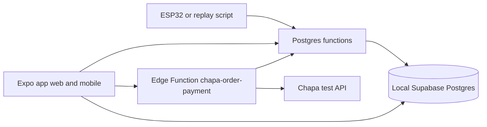

# BunaLens sprint handoff

Written 2026-11-21 for the person running the demo and for a judge asking what
actually works. Detail lives in the phase records named below. No secret
values are in this file.

## Problem, users, and decisions

A Jimma-zone washing station takes a farmer's coffee, keeps it in a warehouse
zone, and today has no single record a buyer can trust. The farmer needs to
know what is wrong with the lot. The station operator needs to decide whether
the lot may be offered. The buyer needs to compare lots and order from the
station, without a broker in between.

| Person | Decision this build supports |
|---|---|
| Station operator | Register a lot, see the zone's air temperature and humidity, read photo feedback, and publish only an eligible lot |
| Reviewer | Resolve a lot the rules cannot decide, using recorded evidence |
| Administrator | Approve a station as a seller, and override a failed rule with an audit record |
| Buyer | Filter published lots, read the evidence, and order a quantity at the station's price |
| Seller | Accept or reject an order, record handover, and see a payment only after Chapa confirms it |

There is no separate farmer login. The farmer's name is text on the lot.

## What was implemented

One lot id (`coffee_batches.id`) runs through:

1. Operator registers the lot.
2. A simulated ESP32 in a warehouse zone sends temperature and humidity. A replay does not duplicate the reading.
3. A demo-fixture photo assessment is saved on that lot (live Gemini was not run).
4. Recorded evidence is judged by a DEMO listing policy: pass, fail, or manual review.
5. The seller publishes an eligible lot. The database checks the rules again.
6. A buyer filters, opens the evidence, and submits an order. The seller accepts. Stock drops in the same transaction.
7. The buyer pays in Chapa test mode. The server verifies with Chapa. The order becomes `paid_test`. Acceptance is not payment.

## Architecture



The app talks to Postgres through the REST API. Clients cannot write lots,
listings, orders, evidence, or payments. The Chapa function is the only sprint
code that calls a payment provider. Station-credit checkout is a separate pair
of functions and was not changed.

## Implementation paths

| Piece | Path |
|---|---|
| Lot, zone, device, readings | `supabase/migrations/20261121140000_hackathon_device_ingestion.sql` |
| Screening rules | `supabase/functions/_shared/screening.ts` |
| Demo photo assessment | `supabase/migrations/20261121143000_hackathon_photo_screening.sql` |
| Listing policy, evidence, review | `supabase/migrations/20261121144500_hackathon_publication_eligibility.sql` |
| Listings and orders | `supabase/migrations/20261121145500_hackathon_marketplace_orders.sql` |
| Order payments | `supabase/migrations/20261121150500_hackathon_order_payments.sql`, `supabase/functions/chapa-order-payment/index.ts` |
| Lot screen | `app/batch/[id].tsx` and `components/Lot*.tsx` |
| Marketplace, listing, orders | `app/(tabs)/marketplace.tsx`, `app/market/[id].tsx`, `app/market/orders.tsx` |
| Checks | `scripts/hackathon/verify-*.mjs`, `supabase/tests/hackathon_order_payment_check.sql` |

Phase records: `docs/FOUNDATION.md`, `docs/DEVICE_INGESTION.md`,
`docs/PHOTO_SCREENING.md`, `docs/ELIGIBILITY.md`, `docs/MARKETPLACE.md`,
`docs/ORDER_PAYMENTS.md`.

## Start the demo

The local Supabase stack `bunalens-db-test-20261118-165455` must already be
running (API on port 54321). From the sprint checkout:

```
npx expo start --web --port 8082
```

Open `http://127.0.0.1:8082`. Port 8081 is used by another app on this machine.

Rebuild check, output outside the repo:

```
npx expo export --platform web --output-dir %TEMP%\bunalens-hackathon-backup\web-export-p8
```

There is no lint script in `package.json`. `npm run typecheck` is the type check.

## Environment variable names

Client, in the ignored `.env` (local stack): `EXPO_PUBLIC_SUPABASE_URL`,
`EXPO_PUBLIC_SUPABASE_ANON_KEY`, `EXPO_PUBLIC_SUPABASE_PUBLISHABLE_KEY`,
`EXPO_PUBLIC_BUNALENS_SYNC_URL`, `EXPO_PUBLIC_CHAPA_INITIALIZE_URL`,
`EXPO_PUBLIC_CHAPA_DEMO_MODE`, `EXPO_PUBLIC_ENABLE_REAL_PAYMENTS`,
`EXPO_PUBLIC_DEMO_MODE`, `EXPO_PUBLIC_CERTIFICATE_VERIFY_BASE_URL`.
Optional for order pay from the app: `EXPO_PUBLIC_CHAPA_ORDER_PAYMENT_URL`.

Backend, ignored: `BUNALENS_TEST_SUPABASE_URL`, `BUNALENS_TEST_SUPABASE_ANON_KEY`,
`BUNALENS_TEST_SUPABASE_SERVICE_ROLE_KEY`, `BUNALENS_TEST_DB_CONTAINER`,
`SUPABASE_SECRET_KEY`, `CHAPA_SECRET_KEY` (test key only, in
`supabase/functions/.env`), `BUNALENS_INTERNAL_FUNCTION_KEY`.
Optional: `CHAPA_ORDER_CALLBACK_URL`, `CHAPA_ORDER_RETURN_URL`, `GEMINI_API_KEY`
(not set).

Demo password names, ignored, in `.env.backend`:
`BUNALENS_DEMO_SELLER_PASSWORD`, `BUNALENS_DEMO_SELLER_B_PASSWORD`,
`BUNALENS_DEMO_REVIEWER_PASSWORD`, `BUNALENS_DEMO_ADMIN_PASSWORD`,
`BUNALENS_DEMO_BUYER_PASSWORD`, `BUNALENS_DEMO_BUYER_B_PASSWORD`,
`BUNALENS_DEMO_DEVICE_TOKEN`, `BUNALENS_DEMO_LOT_ID`.

## Migrations and demo data

Six sprint migrations under `supabase/migrations/2026112113*.sql` and
`2026112114*.sql` and `2026112115*.sql`. Applied with `psql` to the local
database only. Pending on hosted production. Do not apply them there during
this sprint.

Rebuild the labelled demo data, in this order. The scripts are idempotent and
use normal sign-in. Role assignment inside the eligibility script uses the
local service role and is marked in that file.

```
node scripts/hackathon/verify-device-ingestion.mjs
node scripts/hackathon/verify-photo-screening.mjs
node scripts/hackathon/verify-eligibility.mjs
node scripts/hackathon/verify-marketplace.mjs
```

| Account | Role |
|---|---|
| `demo-seller@bunalens.test` | Seller and operator, DEMO Gomma Washing Station |
| `demo-seller-b@bunalens.test` | Second seller, DEMO Mana Washing Station |
| `demo-reviewer@bunalens.test` | Reviewer (`app_metadata.role`) |
| `demo-admin@bunalens.test` | Administrator |
| `demo-buyer@bunalens.test`, `demo-buyer-b@bunalens.test` | Buyers |

Zone "Zone A", simulated device `esp32-sim-zone-a`. Lots:

| Lot | State |
|---|---|
| BNL-JMA-FDEF | Warehouse reading and demo photo screening. Not evaluated, not listed |
| BNL-JMA-0688 | Pass. Published, Gomma, green beans, 498 kg, 450 ETB/kg. Includes one paid test order of 2 kg |
| BNL-JMA-A8E5 | Fail: bean moisture 14.2% is above 12. Private |
| BNL-JMA-7687 | Manual review: warehouse humidity offered as moisture. Private |
| BNL-JMA-B7E4 | Published, Mana, green beans, 400 kg, 520 ETB/kg |
| BNL-JMA-6D1D | Published, Gomma, red cherries, 800 kg, 38 ETB/kg |

Every name, price, reading, and assessment above is synthetic and labelled
DEMO or SIMULATED. The stored "photo" on FDEF is a generated 1x1 placeholder,
not a coffee photograph, and the screening says the photo was not analysed.

## Hardware and replay

No board was connected. Payload and the sketch are in
`docs/DEVICE_INGESTION.md` and `hardware/esp32_zone_sensor/esp32_zone_sensor.ino`
(not compiled). Replay the same path the device uses:

```
node scripts/hackathon/replay-device-reading.mjs
node scripts/hackathon/replay-device-reading.mjs
```

The second run reports `duplicate` and the same reading id. A new message id:

```
node scripts/hackathon/replay-device-reading.mjs --message-id sim-zone-a-000002
```

The lot screen says "SIMULATED DATA — not from a physical sensor" and says the
humidity is not bean moisture.

## Dataset and model

Inspection only, in `docs/PHOTO_SCREENING.md` and `ml/dataset_inspection.json`.
No images were opened. No model was trained. PyTorch is not installed.
`ml/train_mobilenetv3_small.py` has never been executed. Nothing in the app
runs a trained model.

| Dataset | License | Finding |
|---|---|---|
| patopucho/lojano-arabica-coffee | CC BY-NC 4.0 | Green beans, good/defective folders. Suitable later. Non-commercial |
| j4ckdev/green-coffee-beans-dataset | CC BY-NC-SA 4.0 | 11 photos. Too few to train |
| harisyunanda/dataset-coffee-cherry | ODbL | 432 cherry images, three ripeness classes. Boxes not inspected |
| sot2542/coffee-bean-dataset-v2, gpiosenka/coffee-bean-dataset-resized-224-x-224 | CC BY-SA 4.0 | Roast colour, not defects. Not used |
| asimmahmudov/top-rated-coffee | CC0 | Product ratings. Not used |

## Publication rules

Policy `demo-policy-2026-11-21`, stored in the database. Sprint thresholds,
not a national standard and not export certification. Official grade stays
Unclassified.

| Input | Green beans | Red cherries |
|---|---|---|
| Defect percentage | Fail above 8% by weight, hand-sorted weighed sample | Fail above 10% by count, hand count |
| Bean moisture | Fail below 9% or above 12%, moisture meter | Not applied |
| Bean size | Fail below screen 14, sieve set | Not applied |
| Visible damage | Pass to 10%, review to 25%, fail above, from the saved screening | Same |

Warehouse humidity is never accepted as bean moisture. A missing or
unaccepted method goes to manual review. A clear violation fails with that
reason. Examples: 0688 passes, A8E5 fails on moisture 14.2%, 7687 needs review.

## Buyer filters, orders, stock, payment

Browse filters, applied on the server: origin woreda, coffee stage, minimum
and maximum ETB per kg.

Order status: submitted, accepted, declined (shown as rejected), cancelled,
fulfilled. Payment status, separate: unpaid, pending, failed, paid_test, paid.
Phase 7 never sets `paid`. The one verified order is `paid_test`.

Submitting does not hold stock. Accepting decrements it in one transaction;
at 0 kg the listing becomes sold out and leaves the public read. Rejecting
does not change stock. Cancelling a submitted order does not. Cancelling an
accepted unpaid order returns the kilograms. A paid or fulfilled order cannot
be cancelled. An open checkout blocks cancellation for 30 minutes; after it
expires the payment is failed and the order can be cancelled. Success
arriving after cancellation is stored and flagged for a manual refund. The
order and the stock are not changed. There is no payout, settlement, escrow,
or wallet.

## Three-minute walkthrough

1. Sign in as `demo-seller@bunalens.test` (password in `.env.backend`).
   Open `/batch/lot_09c6c65cbf0f458f85db38ea7a2830f3`. Read the simulated
   zone reading and the demo photo screening. Both say what they are.
2. Open the Market tab. Three published lots. Choose Mana: one lot remains.
   Open it and read price, kilograms, and evidence sources.
3. Sign out (Settings). Sign in as `demo-buyer@bunalens.test`. Open
   `/market/orders`. The 2 kg order on BNL-JMA-0688 reads "Order accepted,
   paid (TEST payment)" and names the Chapa reference. The seller's orders
   screen shows "Payments verified with Chapa: 1, 900 ETB — all TEST
   payments. No money was received, settled or paid out."

## What a centre still has to do with equipment and people

- Mount one ESP32 and a temperature-humidity sensor per zone and send a live message.
- Measure defect share, bean moisture, and screen size with the accepted methods. Every reading in the database is simulated.
- Photograph real cherries or beans. No model has analysed a photo.
- A reviewer still decides manual-review lots. There is no reviewer screen; the decision is a function call.
- Agree real listing thresholds. The current numbers are a demo policy.
- Chapa live keys, a public callback URL, and a decision on refunds and payouts.

## Imported baseline versus this sprint

Imported and unchanged in behaviour: Expo app, sign-in, station screen,
scan screen, Gemini function (not called), station-credit Chapa checkout
(not called), certificates, offline queue, credits. Source commit
`3168b3009b02d1bc9ee745954a3d443d77f7bda2`, imported as
`91cae6734c2f40516756b512dd14c5f83712269a`.

Sprint additions: lot registration, zones, devices, readings, photo screening
on an existing lot, demo eligibility policy, marketplace, orders, stock, and
order payments in Chapa test mode. See `docs/SPRINT_STATE.md` for the file list.

The imported certificate card on the lot screen still prints the demo
fixture's score (96) and "Specialty Export" next to the sprint card that says
Unclassified and "photo was not analysed". Do not describe the certificate
block as an official grade.

A buyer has no station, so the Station tab shows the app's built-in local
demo station. Marketplace and orders use the signed-in account.

## Verification

Ran on 2026-11-21 from about 16:01, local stack, this checkout.

| Check | Result |
|---|---|
| `npm run typecheck` | Passed |
| `npx expo export --platform web` | Passed |
| Lint | No lint script. Not run |
| `verify-device-ingestion.mjs` | Passed (includes replay, no duplicate) |
| `verify-photo-screening.mjs` | Passed |
| `verify-eligibility.mjs` | Passed |
| `verify-marketplace.mjs` | Passed, including six parallel acceptances against 300 kg: three accepted, none over stock |
| `hackathon_order_payment_check.sql` | Passed, transaction rolled back. Mismatch, failure, expiry, stock release, late success use simulated provider answers |
| Browser, demo seller | Lot screen: simulated reading, demo screening, eligibility, listing form. Market: three lots, Mana filter leaves one. Listing page shows evidence and price. Orders: 900 ETB test total |
| Browser, demo buyer | Orders: "Order accepted, paid (TEST payment)", Chapa reference shown, "no money moved" |
| Trained model on a new image | Not run. No model exists |
| Chapa verify called again | Not in this phase. The payment row from Phase 7 is still `verified` / `paid_test`, and both screens show it |

### Capability status

| Capability | Status | Evidence | Blocker or next action |
|---|---|---|---|
| Sign-in, station screen, scan screen, credits | Live-tested as imported behaviour; station and sign-in opened again this phase | Browser, demo seller and demo buyer | Buyer has no station, so the Station tab shows the built-in demo station |
| Warehouse reading on the correct lot | Locally tested, simulated | Device script this phase; lot screen shows 22.4 °C, 61.5 % RH, Zone A, device `esp32-sim-zone-a` | Send one live ESP32 message |
| Replay does not duplicate | Locally tested | Device script and `replay-device-reading.mjs` | Same |
| Photo feedback saved on the lot | Locally tested, demo fixture | Photo script; lot screen shows the screening card and says the photo was not analysed | Set `GEMINI_API_KEY` and serve `coffee-sync` from this checkout |
| Failed, unreviewed, unpublished lots stay private | Locally tested | Eligibility and marketplace scripts; public list showed only the three published lots | Add a reviewer screen |
| Eligible published lots in search, with filters | Locally tested | Marketplace script; browser filter for Mana left one lot | None for the demo |
| Buyer submits, seller accepts | Locally tested | Marketplace script, run again this phase | Exercise one order from the screen; the API path is the one that was checked |
| Unrelated user cannot edit, approve, or accept | Locally tested | Eligibility and marketplace scripts | None |
| Concurrent acceptance cannot oversell | Locally tested | Six parallel HTTP accepts against 300 kg, three succeeded, 0 kg left | None |
| Trained model inference | Unimplemented | No weights, no training run | Install PyTorch and run `ml/train_mobilenetv3_small.py`; do not show it in the app until it runs |
| Chapa test payment verified on the server | Live-tested in Phase 7; shown in the app this phase | Order `paid_test`, reference `BNLO-5d62cb9fe7bf4963822b3f7b0902099b`, 900 ETB, both order screens | Serve `chapa-order-payment` (see `docs/ORDER_PAYMENTS.md`) before a new checkout. Failed Chapa checkouts were simulated, not produced on Chapa |
| Station-credit checkout | Implemented but unverified | Code unchanged; `station_payments` rows unchanged | One credit purchase in test mode |
| Payout, settlement, escrow, wallet | Unimplemented | No code and no provider support was verified | Do not claim them |
